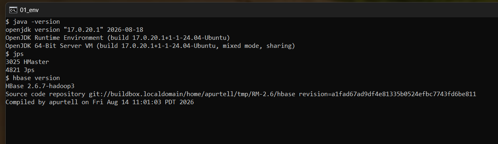
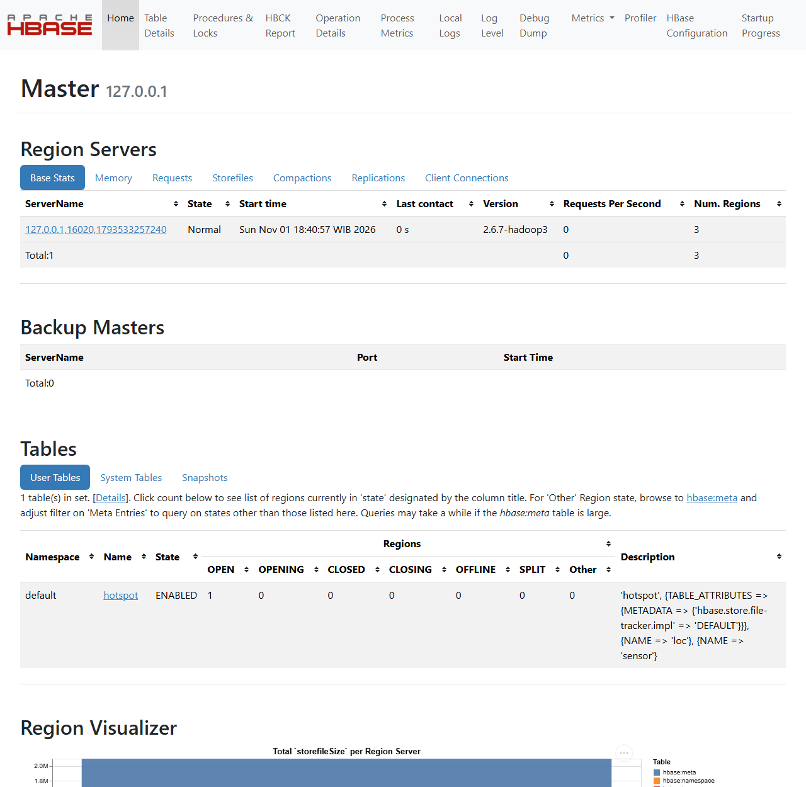
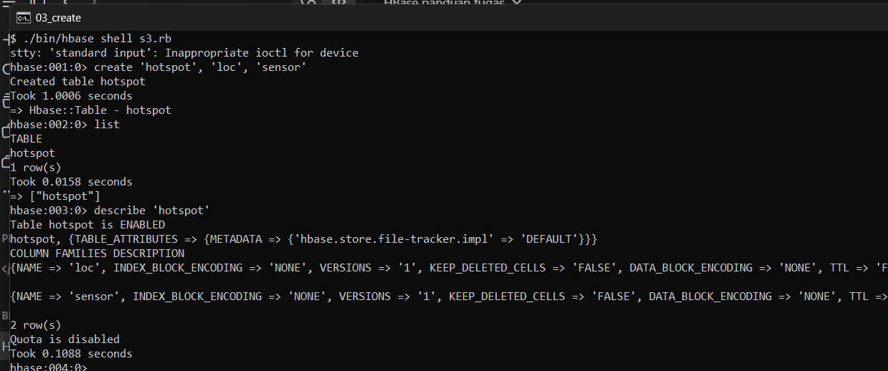
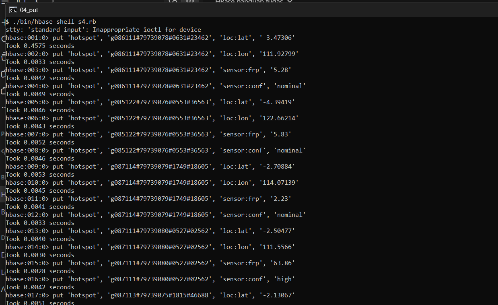
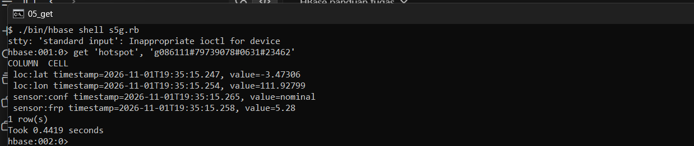
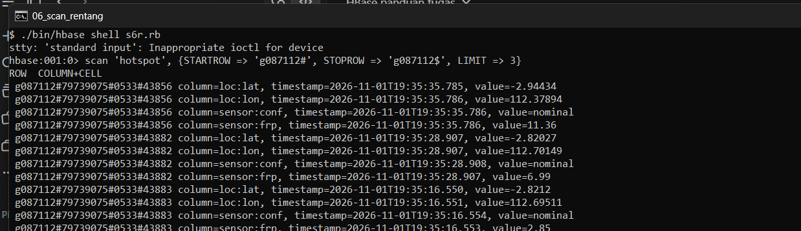
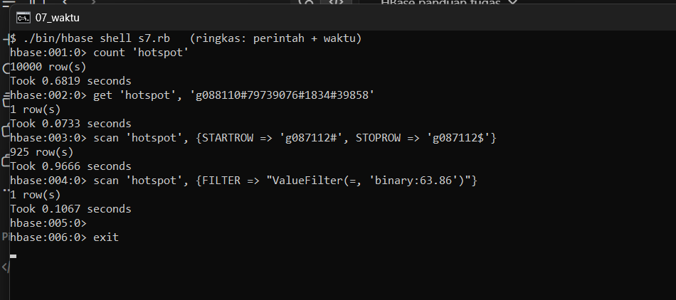
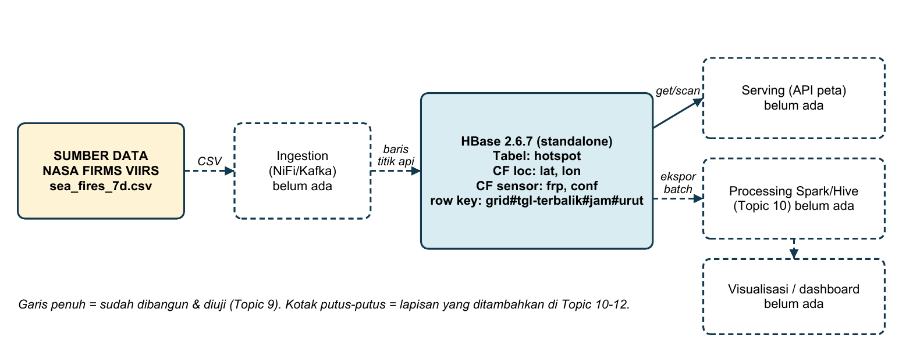

# Case Study Brief dan Desain Storage HBase: Pemantauan Titik Api Indonesia

Teknologi Big Data - Topic 9 - Tugas Kelompok

| Kelompok 6 | NPM | Pembagian tugas |
|---|---|---|
| Muhammad Bryan Farras | 2306230975 | Bab 1 (case study, 4V, pertanyaan data) dan Bab 4 (perbandingan) |
| Mirza Adi Raffiansyah | 2306210323 | Bab 2 (skema, 5 baris contoh, uji hotspot) |
| Calvin Wirathama Katoroy | 2306242395 | Bab 3 (instalasi HBase, hands-on, screenshot, uji waktu) |
| Salim | 2306204604 | Bab 5 (Catatan Keputusan Desain), diagram v0.1, penyusunan PDF |

## Bab 1. Case Study Brief

**Kasus.** Sistem pemantauan titik api (hotspot) kebakaran hutan dan lahan di Indonesia. Sumbernya adalah deteksi satelit VIIRS NASA FIRMS (latitude, longitude, waktu deteksi, FRP, confidence). Kasus yang sama dipakai pada tugas MapReduce kelompok (dataset `sea_fires_7d.csv`, 19-25 September 2026), sehingga seluruh angka di bawah dihitung dari data tersebut. Pengguna sistem adalah petugas pemantau yang membuka peta per wilayah dan melihat titik api terbaru.

| V | Angka dan alasan (dihitung dari data kelompok) |
|---|---|
| **Volume** | Sampel 7 hari: 64.389 baris se-Asia Tenggara, 54.516 baris di kotak Indonesia (lat -11..6, lon 95..141), file 5,3 MB (±82 byte/baris). Rata-rata 7.788 titik/hari, setara ±2,8 juta/tahun. *Asumsi:* 3 sensor VIIRS dan arsip 10 tahun, sehingga ±85 juta baris (±7 GB CSV; ±20-30 GB di HBase karena row key diulang pada tiap sel). |
| **Velocity** | Rata-rata hanya 0,09 titik/detik, tetapi datang berkelompok per lintasan satelit. *Asumsi:* ±4 unggahan efektif per hari, ±2.000 baris tiap unggahan. Ada lonjakan musim kemarau: 10.974 titik pada 19 Sep melawan 5.686 pada 25 Sep (hampir 2 kali lipat dalam 6 hari). |
| **Variety** | CSV terstruktur (13 kolom: koordinat, waktu, brightness, FRP, confidence, day/night). Dapat bertambah dengan data semi-terstruktur (GeoJSON batas wilayah, cuaca) dan laporan teks warga. Satelit berbeda memberi kolom yang berbeda. |
| **Veracity** | Confidence: nominal 91,9% (50.095), low 4,3% (2.331), high 3,8% (2.090). FRP berkisar 0,17-824,73 MW (rata-rata 7,45), jadi ada pencilan ekstrem. Kotak lat/lon kasar ikut menangkap sebagian Malaysia, Papua Nugini, dan Timor Leste; 0 duplikat persis pada sampel. Titik confidence low perlu ditandai, bukan dibuang. |

**Pertanyaan data** (sel grid = kotak 1 derajat x 1 derajat, ada 300 sel berisi titik pada sampel)

| No | Pertanyaan | Jenis akses | Seberapa sering | Dijawab oleh |
|---|---|---|---|---|
| 1 | Tampilkan 20 titik api terbaru pada sel grid X (peta wilayah) | Scan rentang sempit | Setiap peta dibuka | **HBase** |
| 2 | Tampilkan detail satu titik api (klik pada peta) | Lookup per key (get) | Puluhan kali per menit | **HBase** |
| 3 | Titik api pada sel X dalam N hari terakhir | Scan rentang sempit | Beberapa kali per menit | **HBase** |
| 4 | Titik api confidence *high* dengan FRP > 50 MW untuk peringatan | Filter lintas sel | Tiap jam | Spark (Topic 10) |
| 5 | Jumlah titik api per provinsi per hari dan tren harian | Agregasi | Sekali sehari | Hive/Spark (Topic 10) |

## Bab 2. Desain Skema HBase

**Tabel** `hotspot` dengan dua column family. **Row key** = `grid#tanggal_terbalik#jam#urut`, contoh `g087112#79739075#0533#43856`.

- `grid` = `g` + (floor(lat)+90, 3 digit) + floor(lon) (3 digit), jadi `g087112` adalah lat -3..-2, lon 112..113 (Kalimantan Tengah).
- `tanggal_terbalik` = 99999999 - yyyymmdd, sehingga titik api terbaru terurut paling depan dan pertanyaan 1 dan 3 cukup satu scan dari awal awalan grid.
- `urut` menjamin key unik bila dua titik terdeteksi pada jam yang sama.

**Column family.** `loc` (lat, lon: dibaca untuk menggambar peta) dan `sensor` (frp, conf: dibaca untuk detail dan penyaringan). Dua family sudah cukup (anjuran 1-3), dan data yang jarang dipakai dapat dipisah tanpa menambah family. Qualifier boleh berbeda antar baris; sensor lain (mis. MODIS) dapat menambah kolom `sensor:brightness` tanpa mengubah skema.

**5 baris contoh** (diambil dari data nyata, dimuat pada Bab 3):

| Row key | loc:lat | loc:lon | sensor:frp | sensor:conf |
|---|---|---|---|---|
| g085122#79739076#0553#36563 | -4.39419 | 122.66214 | 5.83 | nominal |
| g086111#79739078#0631#23462 | -3.47306 | 111.92799 | 5.28 | nominal |
| g087111#79739080#0527#02562 | -2.50477 | 111.5566 | 63.86 | high |
| g087113#79739075#1815#46688 | -2.13067 | 113.78811 | 4.37 | nominal |
| g087114#79739079#1749#18605 | -2.70884 | 114.07139 | 2.23 | nominal |

### Uji hotspot di atas kertas (1.000 tulisan baru per detik)

**(a) Apakah key baru berawalan sama atau berurutan?** Tidak. Awalan adalah grid, dan titik api baru muncul di banyak sel sekaligus (300 sel berisi titik pada sampel 7 hari), sehingga tulisan menyebar ke banyak region. Tanggal berada setelah grid, jadi waktu tidak membuat key menumpuk di ujung tabel. Tabel tetap perlu di-*pre-split* menurut awalan grid agar tidak mulai dari satu region.

**(b) Jika 80% trafik menuju satu key/sel?** Satu RegionServer menjadi hotspot; ini mungkin terjadi karena sel g087112 sendiri sudah memegang 5.107 dari 54.516 titik (9,4%). Pengurangannya: pecah sel panas menjadi 0,25 derajat dan tambah awalan *salt* (urut mod 4) pada sel panas saja. Konsekuensinya, tulisan lebih menyebar tetapi scan satu sel menjadi 4 scan kecil yang digabung di klien.

**(c) Apakah pertanyaan paling sering masih satu get/scan sempit?** Ya, pertanyaan 1-3 tetap satu `get` atau satu `scan` STARTROW/STOPROW pada satu awalan grid (Bab 3: 925 baris sel g087112 terbaca tanpa memindai 9.075 baris lain). Kelemahannya, viewport peta yang menyeberang batas sel butuh beberapa scan, dan pertanyaan 4-5 memang tidak efisien di HBase.

## Bab 3. Bukti Hands-on

**Lingkungan.** Windows 11 + WSL2, Ubuntu 24.04 LTS, OpenJDK 17.0.20.1, Apache HBase 2.6.7 (hadoop3-bin), mode standalone. Data disimpan di `/root/hbase-data` (bukan /tmp). Catatan: karena nama host WSL membuat RegionServer gagal mendaftar ke Master, ditambahkan `hbase.master.hostname` dan `hbase.regionserver.hostname` = 127.0.0.1 di hbase-site.xml.

**Batasan:** standalone = master, RegionServer, dan ZooKeeper dalam satu proses di satu mesin, sehingga tidak mencerminkan replikasi, failover, atau pembagian region antar server.

**Gambar 1.** `java -version`, `jps` (HMaster berjalan), dan `hbase version` 2.6.7. Menjawab: lingkungan dan instalasi berjalan.

**Gambar 2.** Antarmuka web http://localhost:16010: satu RegionServer Normal, versi 2.6.7-hadoop3, tabel hotspot terdaftar. Menjawab: Master dan RegionServer hidup.

**Gambar 3.** `create 'hotspot','loc','sensor'`, `list`, dan `describe`. Menjawab: skema dua family dari Bab 2 sudah terbentuk dan ENABLED.

**Gambar 4.** `put` untuk lima baris contoh Bab 2 (4 kolom per baris; tampak 17 put pertama, sisanya sama pola). Menjawab: data titik api nyata masuk ke key yang dirancang.

**Gambar 5.** `get` satu row key. Menjawab pertanyaan 2: detail satu titik api per klik (0,44 detik adalah panggilan pertama, saat belum ada cache).

**Gambar 6.** `scan` STARTROW 'g087112#' STOPROW 'g087112$' LIMIT 3. Menjawab pertanyaan 1 dan 3: titik api pada satu sel grid, berurutan dari yang terbaru, tanpa membaca sel lain.

**Gambar 7.** Setelah 10.000 baris titik api nyata dimuat (±24 detik): `count`, `get`, scan rentang, dan scan dengan ValueFilter. Menjawab: biaya tiap pola akses.

| Perintah (10.000 baris) | Baris diproses | Baris dikembalikan | Waktu (shell) |
|---|---|---|---|
| get satu row key | 1 | 1 | 0,0733 detik |
| scan rentang sel g087112 (tanpa LIMIT) | 925 | 925 (3.700 sel) | 0,9666 detik |
| scan ValueFilter(=, 'binary:63.86') | 10.000 (semua) | 1 | 0,1067 detik |

**Kesimpulan.** **get** adalah yang tercepat karena key langsung menunjuk ke satu baris dan biayanya tidak ikut naik bila tabel membesar. Scan rentang 0,97 detik terlihat lebih lambat bukan karena membaca banyak, melainkan karena mengembalikan dan mencetak 925 baris (LIMIT 3 pada Gambar 6 hampir instan). Filter harus memeriksa seluruh 10.000 baris; pada ukuran ini masih cepat (0,107 detik) karena tabel kecil dan sudah di memori, tetapi biayanya tumbuh linear dengan ukuran tabel, sedangkan get dan scan sempit tidak. Waktu hanya dari satu kali jalan di laptop kami; yang dinilai adalah pola, bukan angka mutlak.

## Bab 4. Perbandingan HBase dengan PostgreSQL/PostGIS

| Kriteria | HBase | PostgreSQL (+PostGIS) |
|---|---|---|
| **Pola akses utama** | Get dan scan per sel grid + waktu: row key membuatnya satu scan sempit (Gambar 6, 925 baris dari 10.000). | Cepat dengan indeks spasial/B-tree, tetapi indeks harus dirawat dan melambat bila tabel berisi puluhan sampai ratusan juta baris. |
| **Skala tulis** | Unggahan berkelompok per lintasan (±2.000 baris), arsip 85 juta baris; tulis menyebar antar region dan tambah mesin untuk skala. | Satu server utama menerima tulis; pada 85 juta baris + indeks, perawatan (vacuum, reindex) makin berat. |
| **Join dan agregasi** | Tidak ada. Pertanyaan 4-5 (per provinsi, tren harian) harus lewat Spark/Hive. | Kuat: GROUP BY dan join ke tabel provinsi langsung dengan SQL. |
| **Skema** | Luwes: sensor baru menambah qualifier tanpa migrasi. | Kaku: kolom baru per sensor butuh ALTER TABLE atau banyak NULL. |
| **Transaksi** | Konsisten per baris; data titik api tulis-sekali, jadi cukup. | ACID penuh; tidak terpakai pada data deteksi yang tidak diubah. |
| **Operasional** | Berat (ZooKeeper, HMaster, RegionServer, idealnya HDFS); di sini hanya standalone. | Ringan dan dikenal luas. |
| **Kesimpulan kasus ini** | Dipilih untuk penyimpanan event titik api. | Dipakai untuk data referensi (batas provinsi, akun pengguna). |

**Kriteria paling menentukan:** pola akses dan skala tulis. Pertanyaan yang paling sering diajukan (1-3) semuanya berbentuk "satu sel grid pada rentang waktu", yang dapat dibuat menjadi satu scan sempit hanya dengan merancang row key; data juga hanya bertambah dan tidak diubah. Kelemahan terbesar HBase yaitu tidak ada join dan agregasi kami terima, karena pertanyaan 4-5 jarang (jam-an dan harian) dan akan dikerjakan di lapisan processing (Topic 10).

## Bab 5. Catatan Keputusan Desain dan Diagram Arsitektur v0.1

| Bagian | Isi |
|---|---|
| **Keputusan** | Event titik api (VIIRS) Indonesia disimpan di HBase, tabel *hotspot*, row key grid#tanggal-terbalik#jam#urut, family loc dan sensor. |
| **Konteks** | Sampel kami: 54.516 titik/7 hari (±2,8 juta/tahun), proyeksi ±85 juta baris. Pengguna membuka peta per sel dan butuh 20 titik terbaru pada satu sel dalam waktu kurang dari 1 detik (terukur 0,07 detik untuk get dan 0,97 detik untuk scan 925 baris). Tulis datang berkelompok dengan lonjakan musim kemarau (10.974 titik/hari pada puncak sampel). |
| **Alternatif ditolak** | **PostgreSQL/PostGIS** sebagai penyimpan event: tulis terpusat di satu server dan indeks membengkak pada puluhan juta baris; hanya dipakai untuk data referensi. **Hive**: bagus untuk agregasi harian tetapi tidak cocok untuk lookup berlatensi rendah per key. |
| **Konsekuensi** | Tidak ada join dan agregasi bawaan: laporan per provinsi dan tren dikerjakan di Spark/Hive. Row key tetap setelah dibuat; query berdasar provinsi atau confidence saja menjadi scan penuh (butuh tabel indeks sendiri). Sel panas (g087112 = 9,4% data) perlu pre-split dan salt; viewport lintas sel butuh beberapa scan. Standalone belum menguji replikasi dan failover; operasional HBase lebih berat daripada PostgreSQL. |
| **Bukti** | Gambar 3 (skema), 4 (put), 5 (get 1 baris), 6 (scan sel g087112), 7 (get 0,073 detik, scan 925 baris 0,97 detik, filter penuh 0,107 detik pada 10.000 baris). |

**Diagram arsitektur v0.1** (garis penuh = sudah dibangun dan diuji pada Topic 9; kotak putus-putus = lapisan yang ditambahkan pada Topic 10-12)

